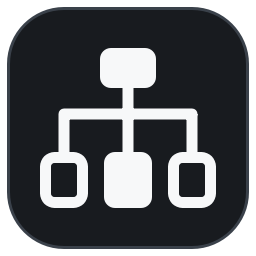

# Network Monitoring

Aplicación de escritorio para **Windows y Linux** que mapea la red automáticamente y genera un
diagrama **draw.io** con iconos por tipo de equipo, puertos y conexiones. El mapa se ve dentro de
la propia aplicación (sin abrir la web de draw.io) y se guarda solo en una carpeta.



## Qué hace

- **Dos modos de escaneo**, a elegir antes de lanzarlo:
  - **SNMP + LLDP/CDP (impacto mínimo).** No barre la red. Parte de la puerta de enlace y de los
    switches/routers que indiques, lee por SNMP sus vecinos LLDP/CDP, sus tablas ARP y sus tablas
    MAC (FDB), y va saltando de vecino en vecino. Solo hace lecturas.
  - **Escaneo completo (activo).** Barre las subredes con ping, comprueba 38 puertos TCP
    habituales, resuelve nombres y después consulta SNMP en todo lo que encuentra. Detecta más
    equipos, pero genera tráfico visible y puede activar alertas del IDS.
- **Topología real**: enlaces confirmados por LLDP/CDP con los puertos de cada extremo y su
  velocidad, equipos finales colocados en el puerto exacto del switch gracias a la tabla MAC,
  clientes Wi-Fi colgando de su punto de acceso, PCs detrás de teléfonos IP y **switches no
  gestionados** detectados cuando un puerto tiene varios equipos detrás sin vecino LLDP.
- **Clasificación automática**: router, firewall, switch L2/L3, AP, servidor, NAS, PC, impresora,
  teléfono IP, cámara, móvil, IoT… a partir de LLDP/CDP, sysDescr, fabricante (OUI), puertos
  abiertos y nombre de host.
- **Diagrama .drawio** jerárquico (Internet → puerta de enlace → núcleo → acceso → equipos), con
  iconos monocromos incrustados, leyenda, cabecera con fecha/modo y todos los datos de cada equipo
  (IP, MAC, fabricante, modelo, puertos…) guardados como propiedades de la forma: en draw.io se
  ven con *Editar datos* o pasando el ratón por encima.
- **Visor integrado** con zoom, desplazamiento, panel de detalles al hacer clic, exportación a PNG,
  tabla de dispositivos e historial de mapas anteriores. El botón *Editar en draw.io* abre el
  fichero en draw.io Desktop si está instalado.
- No necesita permisos de administrador, Npcap ni nmap.

## Instalación

Descarga la última versión desde la pestaña **Releases** del repositorio:

| Sistema | Fichero | Cómo |
|---|---|---|
| Windows 10/11 (64 bits) | `NetworkMonitoring-Setup-x.y.z.exe` | Doble clic y siguiente, siguiente. |
| Windows sin instalar | `NetworkMonitoring-portable-windows.zip` | Descomprimir y abrir `NetworkMonitoring.exe`. |
| Debian / Ubuntu / Mint | `network-monitoring_x.y.z_amd64.deb` | `sudo apt install ./network-monitoring_*.deb` |
| Otras distribuciones | `network-monitoring-x.y.z-linux-x86_64.tar.gz` | Descomprimir y ejecutar `./install.sh` |

GitHub Actions compila los instaladores en cada cambio que llega a `main` y los publica en la
Release `vX.Y.Z` correspondiente a la versión de `netmon/__init__.py`. Para sacar una versión
nueva basta con subir ese número.

## Preparar la red para el modo SNMP + LLDP/CDP

En switches y routers gestionables:

1. Activa **SNMP de solo lectura** (v2c con una comunidad propia, o mejor v3) y permite consultas
   desde el equipo donde corre la aplicación.
2. Activa **LLDP** (o CDP en Cisco). Casi todos los switches gestionables lo traen activado.

Si en un Cisco antiguo las tablas MAC salen vacías, es porque guarda una por VLAN
(`comunidad@vlan`): los enlaces entre switches seguirán apareciendo por LLDP/CDP, y los equipos
finales colgarán del router con línea discontinua (conexión inferida).

## Uso

1. Elige el tipo de escaneo.
2. Indica el alcance: switches/routers de partida (modo SNMP) o subredes (modo completo; el botón
   *Detectar* rellena la subred actual).
3. Introduce las credenciales SNMP y pulsa **Escanear red**.

El mapa se guarda en `Documentos/Mapas de red` (se puede cambiar) con el nombre
`mapa-red_AAAA-MM-DD_HH-MM-SS_modo.drawio`.

### Leyenda de líneas

| Línea | Significado |
|---|---|
| Gruesa continua | Enlace confirmado por LLDP/CDP (con puertos y velocidad) |
| Fina continua | Equipo ubicado por la tabla MAC del switch |
| Discontinua fina | Conexión inferida, sin confirmar |
| Discontinua gruesa | Salida a Internet |

### Línea de comandos

```bash
netmon --cli --mode snmp --seed 192.168.1.2 --community miComunidad
netmon --cli --mode active --target 192.168.1.0/24
netmon --cli --mode snmp --seed 10.0.0.1 --v3-user lector --v3-auth SHA --v3-auth-key ... --v3-priv AES-128 --v3-priv-key ...
```

## Desarrollo

```bash
python -m venv .venv && source .venv/bin/activate      # en Windows: .venv\Scripts\activate
pip install -r requirements.txt
python -m netmon                                       # abre la aplicación
python -m pytest tests
```

Compilar en local:

- **Windows**: `packaging\windows\build.bat` (necesita Inno Setup 6).
- **Linux**: `pyinstaller packaging/netmon.spec --noconfirm && bash packaging/linux/build_linux.sh 1.0.0`

`tests/simnet/make_sim.py` genera una red simulada (router, núcleo, dos switches de acceso, AP,
teléfono, un switch no gestionado y 19 equipos) para probar el modo SNMP con `snmpsim`.

## Estructura

```
netmon/
  core/       escáner: descubrimiento activo, SNMP (LLDP, CDP, ARP, FDB), clasificación, topología
  drawio/     generador y lector de .drawio, iconos SVG
  ui/         interfaz PySide6 y visor integrado
packaging/    PyInstaller, Inno Setup (Windows), .deb y .tar.gz (Linux)
```

Tipografías incluidas: Inter y JetBrains Mono (licencia SIL OFL).
